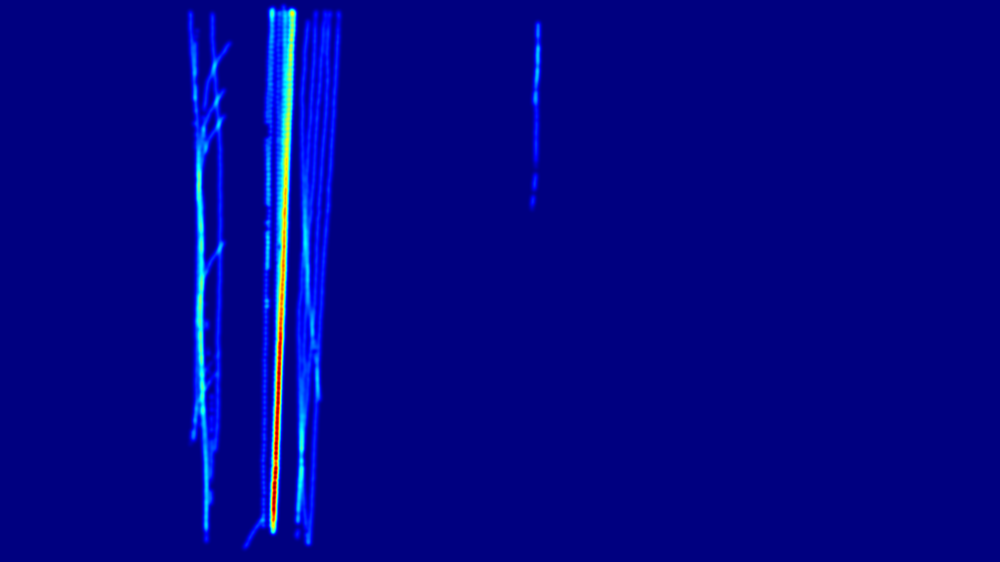
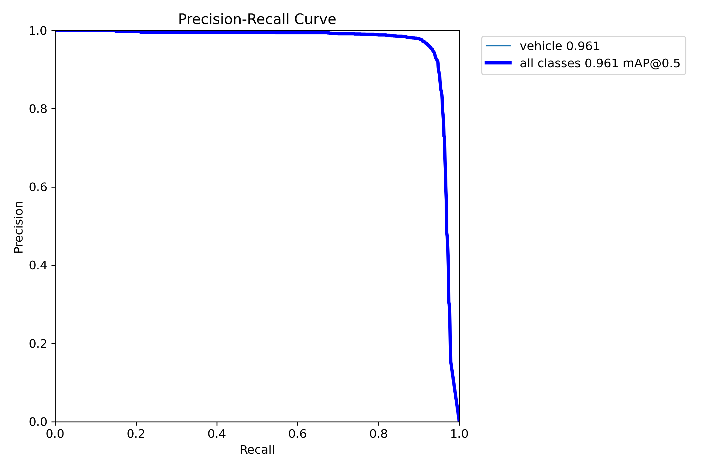
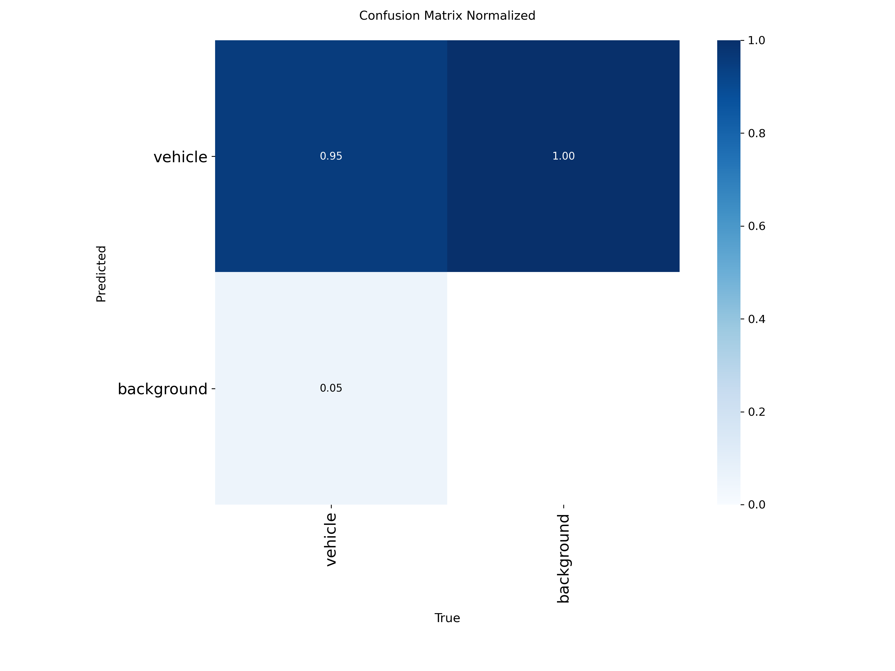

# SkyTrack AI
### Drone-Based Vehicle Detection, Tracking & Traffic Analytics

SkyTrack AI turns raw aerial (drone) video into traffic intelligence. It detects vehicles with a custom-trained **YOLOv8n**, tracks them across frames with **ByteTrack**, removes off-road false positives using a **U-Net road segmentation** model, and then estimates speed, traffic flow, lane distribution and congestion. Each run ends with an annotated video, per-track CSV, heatmap and JSON report.

<!-- Add a 5–10 s demo GIF of the tracked output here:

-->



---

## Results

### Detection: YOLOv8n
Trained for 120 epochs at 960 px on **VisDrone + UAVDT (train)**, evaluated on **UAVDT (val)**.

| Precision | Recall | mAP@0.5 | mAP@0.5:0.95 |
|---:|---:|---:|---:|
| **96.1%** | **92.3%** | **96.1%** | **51.1%** |

<p>
  
  
</p>

Full training curves: [`results.png`](runs/drone_training/yolov8n_Trained2/results.png) · per-epoch log: [`results.csv`](runs/drone_training/yolov8n_Trained2/results.csv)

### Road segmentation: U-Net
U-Net with an ImageNet-pretrained **MobileNetV2** encoder, trained for 20 epochs with **Dice loss** on binary road masks derived from **SkyScapes**.

### Sample pipeline run
From [`phase4/outputs/run_master_report.json`](phase4/outputs/run_master_report.json):

| Unique vehicles | Total detections | Line crossings | Flow | Avg. median speed | Lane split (L / R) | Density | Congestion | Scene |
|---:|---:|---:|---:|---:|---:|---|---|---|
| 29 | 4,448 | 5 | 670.6 veh/hr | 36.3 km/h | 27 / 2 | High | High | Dark/Rainy |

---

## Pipeline

```text
Drone video
   │
   ├─► YOLOv8n vehicle detection            (conf 0.4, IoU 0.5, min box area filter)
   │
   ├─► ByteTrack multi-object tracking      (persistent IDs across frames)
   │
   ├─► U-Net road segmentation filter       (every 5 frames, drops off-road boxes)
   │
   ├─► Speed estimation                     (homography or lane-width calibration)
   │
   ├─► Line-crossing count & lane split     (traffic flow, veh/hr)
   │
   ├─► Trajectories, density & congestion
   │
   ├─► Scene brightness check               (Clear / Dark-Rainy / Night)
   │
   └─► Outputs: annotated video · tracks CSV · heatmap · JSON report
```

### How each stage works
1. **Detection.** The custom-trained YOLOv8n runs frame by frame. Low-confidence and very small boxes are discarded to reduce noise.
2. **Tracking.** ByteTrack associates detections across frames using motion (a Kalman filter) and IoU matching. It keeps both high- and low-confidence boxes so IDs survive brief occlusions.
3. **Road filtering.** The U-Net predicts a road mask every 5 frames, and detections whose centre falls outside the road are removed.
4. **Speed.** Pixel displacement of each track is converted to metres. This uses a homography from 4 manually picked reference points (`homography_helper.py`) when one is available, and otherwise an estimated metres-per-pixel scale based on a standard 3.5 m lane width. Each vehicle's median speed is used to resist jitter.
5. **Flow and lanes.** Vehicles crossing a horizontal counting line are counted and split into left and right lanes, then converted to vehicles per hour.
6. **Analytics.** Track density and movement give the congestion level. Trajectories and a blurred occupancy heatmap show where vehicles travel.
7. **Scene condition.** A simple frame-brightness check labels the footage Clear, Dark/Rainy or Night.

---

## Datasets

| Dataset | Used for | Notes |
|---|---|---|
| [VisDrone](https://github.com/VisDrone/VisDrone-Dataset) | Detector training | Diverse aerial scenes, tiny and dense objects |
| [UAVDT](https://sites.google.com/view/grli-uavdt) | Detector training + validation | Drone traffic videos; the UAVDT val split is the evaluation set |
| SkyScapes | Road segmentation training | Grayscale labels converted to binary road masks |

Data preparation scripts:
- `merge_datasets.py`: merges VisDrone (YOLO format) and UAVDT into one `DroneCombined` train/val set
- `convert_skyscapes_masks.py`: converts SkyScapes grayscale labels into binary road masks
- `check_dataset.py`, `check_coco.py`: sanity checks for images, labels and class IDs

Datasets are not included in this repository (see `.gitignore`). Download them from the official sources.

---

## Repository Structure

```text
SkyTrack-AI/
├── phase4/
│   ├── scripts/
│   │   ├── run_drone_system.py        # ★ end-to-end pipeline (main entry point)
│   │   ├── detect_objects.py          # standalone YOLO detection → CSV
│   │   ├── run_bytetrack.py           # standalone ByteTrack on saved detections
│   │   ├── filter_vehicles_on_road.py # standalone road-mask filtering
│   │   ├── estimate_speed_auto.py     # standalone speed estimation
│   │   ├── traffic_flow_analysis.py   # line-crossing / flow counting
│   │   ├── vehicle_trajectories.py    # trajectory plots
│   │   ├── visualize_tracks.py        # draw tracks on video
│   │   ├── detect_weather.py          # brightness / scene condition check
│   │   ├── homography_helper.py       # pick 4 points → homography.npy
│   │   ├── generate_traffic_report.py # JSON report from track CSV
│   │   └── segmentation/deeplab.py    # alternative DeepLab road mask (experimental)
│   └── outputs/                       # sample outputs (report, tracks, heatmap)
├── runs/drone_training/yolov8n_Trained2/
│   ├── weights/best.pt                # trained YOLOv8n detector
│   ├── results.csv / results.png      # training log & curves
│   └── *_curve.png, confusion_matrix*.png
├── road_segmentation_model.pth        # trained U-Net road segmentation weights
├── train_road_segmentation.py         # U-Net training script
├── merge_datasets.py                  # dataset merge (VisDrone + UAVDT)
├── convert_skyscapes_masks.py         # SkyScapes → binary road masks
├── check_dataset.py / check_coco.py   # dataset validation
├── evaluate_pipeline.py               # compare pipeline counts/speed vs ground truth
└── README.md
```

---

## Installation

```bash
# 1. Environment
conda create -n skytrack python=3.10 -y
conda activate skytrack

# 2. Core dependencies
pip install ultralytics torch torchvision opencv-python numpy pandas scipy matplotlib \
            segmentation-models-pytorch albumentations filterpy lap pyyaml

# 3. ByteTrack (imported as yolox.tracker.byte_tracker)
git clone https://github.com/ifzhang/ByteTrack.git
cd ByteTrack && pip install -r requirements.txt && python setup.py develop && cd ..
```

> A GPU is used automatically if available (`cuda`); otherwise the pipeline runs on CPU.

---

## Usage

### 1. Configure paths
Edit the `CONFIG` block at the top of `phase4/scripts/run_drone_system.py`:

| Variable | Meaning |
|---|---|
| `VIDEO_PATH` | Input drone video |
| `OUT_DIR` | Output folder |
| `YOLO_WEIGHTS` | `runs/drone_training/yolov8n_Trained2/weights/best.pt` |
| `BYTETRACK_PATH` | Path to the cloned ByteTrack repo |
| `SEG_MODEL_PATH` | `road_segmentation_model.pth` (segmentation is skipped if missing) |

Tunable parameters in the same block: `CONF`, `IOU`, `IMG_SZ`, `COUNT_LINE_POS`, `SEG_EVERY_N_FRAMES`, `SEG_THRESHOLD`, `LANE_WIDTH_M`, `MIN_BOX_AREA`, `TRAJECTORY_LEN`.

### 2. (Optional) Calibrate speed with a homography
```bash
python phase4/scripts/homography_helper.py
```
Click 4 reference points on the first frame. This saves `homography.npy` to the output folder, and the pipeline uses it automatically.

### 3. Run the full pipeline
```bash
python phase4/scripts/run_drone_system.py
```

### Outputs

| File | Contents |
|---|---|
| `run_master_tracked.avi` | Annotated video: boxes, track IDs, trajectories, counting line |
| `tracks_master.csv` | Per-frame track positions, IDs and speeds |
| `run_master_report.json` | Vehicle counts, flow, lane split, speed, density, congestion, scene |
| `traffic_heatmap.png` | Vehicle occupancy heatmap |

### Train the models yourself
```bash
# Detector (after running merge_datasets.py)
yolo detect train model=yolov8n.pt data=data_drone.yaml epochs=120 imgsz=960 batch=32

# Road segmentation
python train_road_segmentation.py
```

### Evaluate against ground truth
```bash
python evaluate_pipeline.py   # enter GT vs predicted counts/speed → evaluation_results.json
```

---

## Tech Stack
**Python** · **PyTorch** · **Ultralytics YOLOv8** · **ByteTrack** · **segmentation_models_pytorch** · **OpenCV** · **Albumentations** · NumPy · Pandas · Matplotlib

---

## Limitations & Future Work
- **Tracking metrics:** add MOTA / IDF1 / ID-switch evaluation on UAVDT sequences using TrackEval.
- **Edge optimization:** ONNX / TFLite export, INT8 quantization and CPU latency benchmarks.
- **Speed accuracy:** the lane-width fallback assumes a fixed 3.5 m lane, while homography calibration is more accurate but manual.
- **Scene condition:** the current weather check is brightness-based, and a learned classifier would be more robust.
- **Usability:** replace hard-coded paths with a CLI or config file.

---

## Team
Developed as a team project by:
- **Kushagra Chauhan**
- **Utsav Majumdar**
- **Siddhi Vinayak Dash**

This repository is a personal portfolio copy of the original team project. Credit goes to all team members for design, development, testing and documentation.
